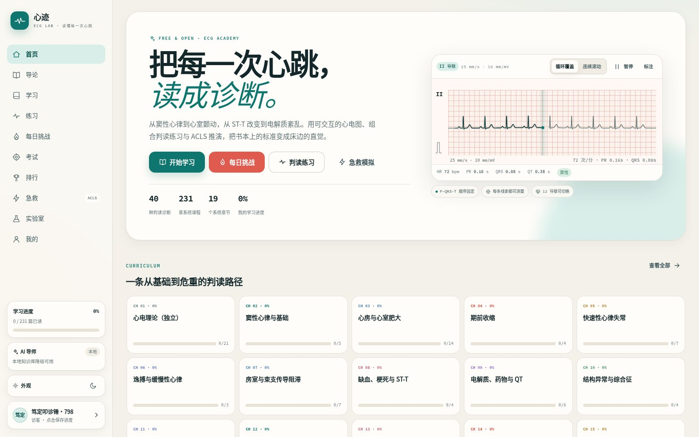
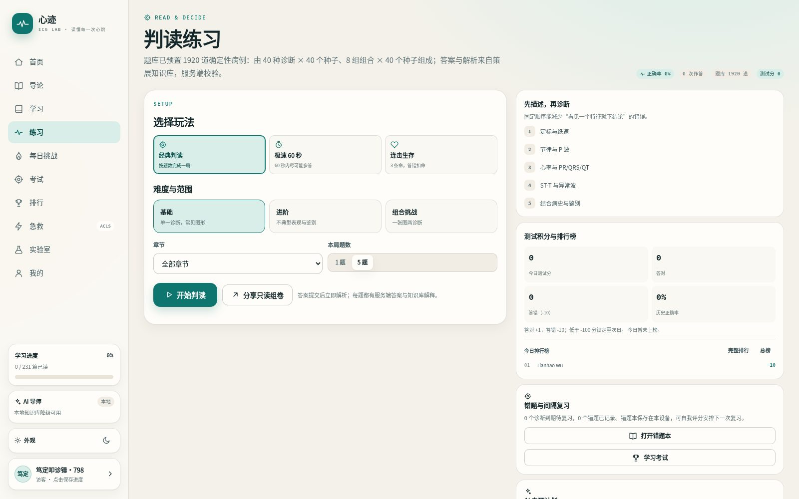
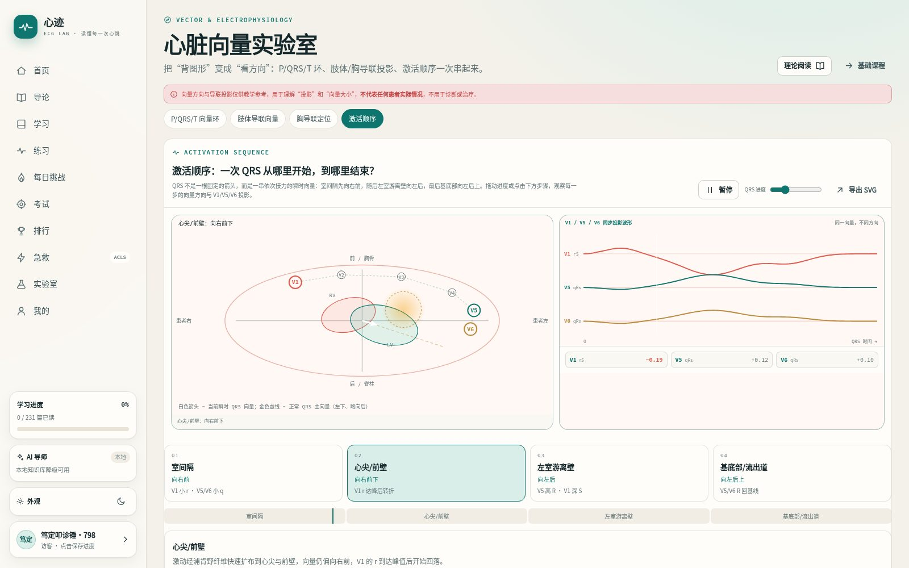

<div align="center">

# 心迹 · ECG Lab

**读懂每一次心跳。**

面向医学生、住院医师与心电图爱好者的开源学习平台：可交互心电波形、结构化课程、判读训练、ACLS 推演与心脏向量实验室。

[在线体验](https://ecg.tianhao.me) · [功能](#功能) · [截图](#截图) · [快速开始](#快速开始) · [自托管部署](#自托管部署) · [参与贡献](#参与贡献)

代码 [MIT](LICENSE) · 教学内容 [CC BY-SA 4.0](LICENSE)

</div>



## 这是什么

传统心电图学习往往停留在静态图片与长文：手机上看不清网格、不能逐搏测量、练习与学习割裂、急救流程只能靠视频记忆。心迹把 **可交互波形、结构化课程、服务端判分与服务端 ACLS 状态机** 放进同一个站点，并且不依赖任何前端构建工具。

- 无需登录即可完整学习；注册后错题本、收藏与复习计划自动同步到账号，可跨设备继续。
- 前后端零构建：原生 ES Modules + Canvas/SVG，PHP 8.4 + MySQL。
- 教学优先：每个波形、向量与结论都标注“教学示意”，不提供针对真实患者的诊疗指令。

## 功能

### 学

- **237 章系统课程**：电生理、导联与向量、心房/心室肥大、缺血与梗死、电解质与药物、起搏与电生理、特殊检查、综合征、儿科、伪差与进阶。
- **导论**：动作电位、传导系统、向量环与导联投影独立成章，配自绘 SVG 示意图、图例与参考资料。
- **可交互 ECG**：500 Hz 波形生成；节律条 / 12 导联、循环覆盖 / 连续滚动、标注、悬停测量、纸速与增益校准。

### 练

- **系统判读训练**：按频率 → 节律 → 电轴 → 间期 → ST-T → 结论六步读图，逐步反馈，最后提交诊断并进入错题本；支持键盘操作、步骤正确率与关联课程。
- **判读练习**：1920 道确定性病例（40 种诊断 × 40 个种子变体 + 组合诊断），支持章节筛选与多选；答错扣 5× 基础分，用时超过 15 秒的答对题记为“不熟练”。
- **三种玩法**：经典判读、极速 60 秒、连击生存。
- **自适应间隔复习**：错题本、收藏、1→3→8→20 天间隔（封顶 90 天），按薄弱诊断组卷。
- **每日挑战**：全站同题 10 题、每天一次、连续打卡日历；独立计分，不影响测试分。
- **学习考试**：板块学习关卡、综合考试、最近 50 题动态评级。
- **排行榜**：今日 / 本周 / 总榜，只展示昵称与分数；今日分每日重置，周/总榜按分数聚合，同分按正确题数排序。
- **等级与解锁**：XP 对应 Lv.1–20，Lv.3 解锁进阶、Lv.5 解锁挑战；答错扣分导致 XP 下降时会降级，管理员可手动设置等级。
- **专项练习**：心梗定位、后壁/右室心梗、房室阻滞、束支与分支阻滞四组专项；配套《心肌梗死定位与 18 导联》《心肌梗死分期与罪犯血管判断》《传导阻滞专题》等文章。

### 推演

- **ACLS 急救模拟**：10 个服务端状态机场景，CPR 质量、除颤/复律、药物时序、可逆病因处理，按时间线复盘评分。

### 工具

- **心脏向量实验室**：P/QRS/T 三维向量环、六轴与肢体导联投影、胸导联定位、四步激活顺序、向量图 SVG 导出。
- **电解质实验室**：K⁺ / Ca²⁺ / Mg²⁺ 滑杆与实时波形变化。
- **AI 导师（可选）**：管理后台配置 OpenAI 兼容供应商；独立 `#/ai` 页面仅回答心电图相关问题，可直接选择错题追问；错题本支持 AI 薄弱项分析（常错 / 不熟练 / 遗忘 → 三天计划）；可按主题、难度、题数让 AI 出 4 选 1 单选题并逐题解析，答错自动并入错题本。回答流式输出、支持 Markdown；游客自动使用本地知识库。管理员调用不限次数。

### 体验

- 深浅双主题（可跟随系统，手动切换后智能回退）、中英界面切换（更多语种待扩展）、PWA 离线外壳、低带宽模式、移动端 320px 起适配、44px+ 触控与 16px+ 表单字号。
- 管理员后台：用户与权限、课程作业、课程包导入/预览/发布、AI 供应商与成本中心、访问统计、游客清理、审计日志。

## 截图

| 判读练习 | 向量实验室 |
| --- | --- |
|  |  |

## 快速开始

环境要求：

- PHP 8.2+（推荐 8.4，需 `pdo_mysql`、`openssl`、`curl`、`mbstring`）
- MySQL 8+
- Node.js 22（仅用于运行测试，站点本身零构建）

```bash
git clone <repository-url> ecg-lab
cd ecg-lab

# 1. 本地数据库配置（不会被提交）
cat > app/config.local.php <<'PHP'
<?php
return ['db' => [
  'host' => '127.0.0.1',
  'port' => 3306,
  'database' => 'ecg_academy',
  'user' => 'ecg_app',
  'password' => 'your-password',
  'charset' => 'utf8mb4',
]];
PHP

# 2. 建库并创建表（需要具有建表权限的数据库账号）
mysql -uroot -p -e "CREATE DATABASE ecg_academy CHARACTER SET utf8mb4 COLLATE utf8mb4_unicode_ci"
# 临时将 config.local.php 指向管理员账号后执行：
php scripts/migrate.php
php scripts/create_admin.php

# 3. 本地启动（内置服务器）
php -S 127.0.0.1:8799 -t public scripts/dev-router.php
```

打开 <http://127.0.0.1:8799>，管理员入口为 `/#/admin`。

> 运行期建议使用只具备 `SELECT / INSERT / UPDATE / DELETE` 的最小权限数据库账号；建表与迁移再临时使用管理员账号。

## 自托管部署

站点入口在 `public/`，`app/`、`data/`、`storage/` 均位于 Web 根目录之外。一个可用的 nginx 示例：

```nginx
server {
    listen 443 ssl http2;
    server_name your-domain.example;
    root /var/www/ecg-lab/public;
    index index.php;

    client_max_body_size 1m;
    add_header X-Content-Type-Options "nosniff" always;
    add_header X-Frame-Options "DENY" always;
    add_header Referrer-Policy "strict-origin-when-cross-origin" always;

    location / { try_files $uri $uri/ /index.php?$query_string; }

    location ~ \.php$ {
        include fastcgi.conf;
        fastcgi_pass unix:/run/php/php8.4-fpm.sock;
        fastcgi_read_timeout 60s;
        # API 的 404 需要原样返回 JSON
        fastcgi_intercept_errors off;
    }

    location ~ \.(js|css)$ {
        add_header Cache-Control "public, max-age=43200";
        expires off;
    }
}
```

说明：

- 带 `?v=` 的静态资源可长缓存；无版本号请求应使用 `no-cache` 重新验证。
- AI 流式接口返回 `X-Accel-Buffering: no`，如前置代理仍缓冲，请关闭对应 location 的 buffering。
- 备份 `app/config.local.php`、`storage/master.key` 与数据库即可完整恢复。

## 配置

所有运营配置都在管理后台 `/#/admin`：

- **站点**：名称、版权、许可证、ICP 备案、GitHub 链接。
- **登录**：是否开放注册与普通用户登录、管理员密码 / Passkey 登录。
- **AI**：多供应商与模型、每日额度、ECG-only 系统提示词、BYOK 开关；每个模型可在供应商设置中单独维护输入/输出单价（每百万 tokens）与折扣时段，成本中心汇总花费与 tokens。
- **班级作业**：生成匿名设备链接，统计人数、次数、平均分与正确率。

## 技术栈

- 后端：PHP 8.4（无框架）、PDO MySQL、AES-256-GCM 令牌、WebAuthn Passkey。
- 前端：原生 ES Modules、Canvas / SVG、Service Worker（PWA）。
- 数据：确定性题库与课程 JSON/PHP 数据文件，无需 CMS。

## 项目结构

```text
app/               后端：路由、控制器、领域逻辑、数据库、鉴权
data/              课程、题库、诊断、场景、勘误等内容数据
docs/              架构、API、数据库、测试、部署、设计、无障碍文档
public/            Web 根目录：SPA 入口、静态资源、Service Worker
scripts/           迁移、校验、导入、运维脚本
tests/             PHP 与 Node 测试
storage/           会话、日志、缓存、备份（Web 不可达）
```

## 测试

```bash
# PHP：学习/考试、排行榜、作业、急救、每日挑战、账号、流量、AI 成本
for t in assignment leaderboard learning sim daily profile traffic ai-cost; do php tests/$t.test.php; done

# Node：波形引擎、播放器、本地复习
node --test tests/engine.test.mjs tests/playback.test.mjs tests/study.test.mjs

# jsdom 全链路 UI 冒烟（需先启动本地服务）
php -S 127.0.0.1:8791 -t public scripts/dev-router.php &
node tests/ui-smoke.mjs

# 内容与题库校验
php scripts/validate_content.php
php scripts/validate_curriculum.php
php scripts/validate_bank.php
php scripts/validate_section_bank.php
```

## 路线图

见 [`docs/ROADMAP.md`](docs/ROADMAP.md)：波形标注器、WFDB/SCP 适配、英文化与 CME 评估等；课程包后台导入与公开浏览已交付。

## 参与贡献

欢迎内容勘误、题目审阅、翻译与工程改进：

1. 先阅读 [`docs/CORRECTIONS.md`](docs/CORRECTIONS.md) 与贡献者协议。
2. 医学内容需注明来源；未完成的审阅不要写成已完成。
3. 提交前运行相关校验与测试；静态资源变更需同步 `asset_version` 与 Service Worker 缓存版本。

## 许可证

- 代码：[MIT](LICENSE)
- 教学内容：[CC BY-SA 4.0](LICENSE)

## 免责声明

本项目用于医学教育与学习，不构成诊疗建议，不能替代临床判断。心电图波形与向量为教学示意；真实患者请遵循所在机构与地区的临床流程。
